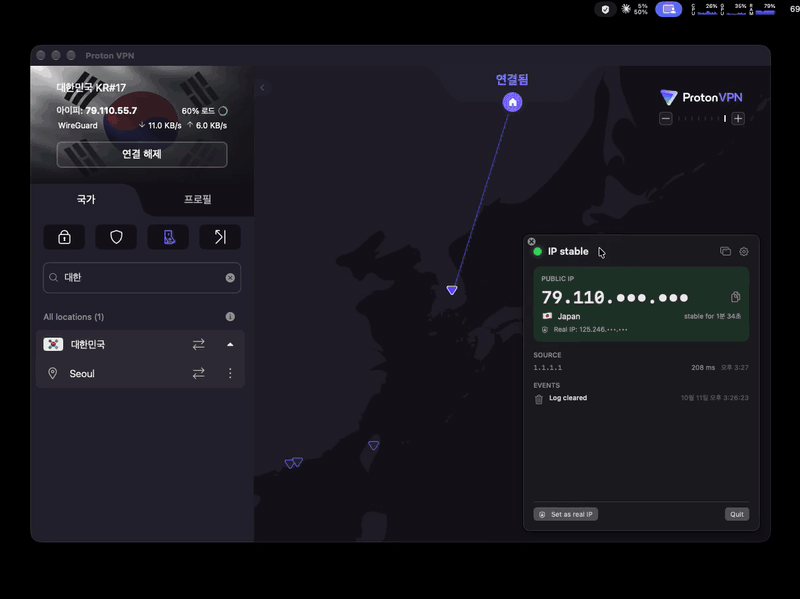

# IP Leak Logger

A small macOS menu bar app that tells you the moment your public IP changes.

If you rely on a VPN, the failure you care about is silent: the tunnel drops, traffic falls back to your real connection, and nothing on screen changes. IP Leak Logger polls your public IP twice a second and raises a notification as soon as it differs from the last value it saw.

It only **detects**. It does not block traffic. If you need that, pair it with a VPN kill switch or firewall rules.



*The VPN client drops out and traffic falls back to the real connection. IP Leak Logger flags the exposure (red), then reports the new exit IP after reconnecting. The real IP in the VPN client is covered in this recording.*

## Install

Requires macOS 13+ and Xcode (Swift 5.9+).

```bash
git clone <this repo>
cd ip-leak-logger
./build.sh
open build/IPLeakLogger.app
```

The build is ad-hoc signed, so macOS may ask you to allow it on first launch. Allow notifications, or alerts won't show.

## Usage

The app lives in the menu bar.

| Icon | Meaning |
| --- | --- |
| Green shield | IP unchanged |
| Orange triangle | IP changed since the last check |
| Red octagon | Your registered real IP was observed |
| Slashed Wi-Fi | Network unreachable |

- Click the icon for the current IP, country, uptime of the current IP and recent events. Drag the popover off the menu bar to turn it into a window.
- **Dismiss** acknowledges a change you made on purpose.
- Register your real (non-VPN) IP under **Settings → Real IP**. Seeing it later triggers the red alert.

Settings cover the check interval, notifications and sound, IP masking, event retention, CSV export and launch at login.

## How it works

- Every 0.5 seconds (configurable) the app asks Cloudflare (`1.1.1.1`) which IP and country your traffic comes from.
- If the answer differs from the previous one, you get a notification and the event is logged.
- Switching networks or toggling a VPN triggers an immediate extra check.
- Three failed checks in a row are reported as "offline", not as a leak.

## Security model

- **Event log**: every entry is encrypted with AES-256-GCM and chained to the previous entry by SHA-256, so deleting or editing entries is detected. Deleting the log also rotates the key.
- **Keychain**: the log key, registered real IP and settings are stored in one Keychain item (`ThisDeviceOnly`).
- **Authentication**: viewing events, exporting, deleting and changing the real IP can require Touch ID or your password.
- **Network**: the only outbound request is the trace call above. Nothing else is sent anywhere.

## Limitations

- IPv4 only. The source is addressed by IP literal, so leaks over IPv6 are not seen.
- A single source (Cloudflare). If it is unreachable you will see "offline" even though your network works.
- Country comes from Cloudflare's database and can differ from what your VPN provider advertises.
- The log's hash chain detects edits and middle deletions, but not truncation of the most recent entries.
- Ad-hoc signed, not notarized.

## Layout

```
Sources/IPLeakLogger/
  IPChecker.swift   IP lookup
  Monitor.swift     polling, change detection, alerts
  LogStore.swift    encrypted, hash-chained event log
  Vault.swift       single Keychain item (key, real IP, settings)
  Views.swift       popover and settings UI
  App.swift         status item, popover, windows
```
